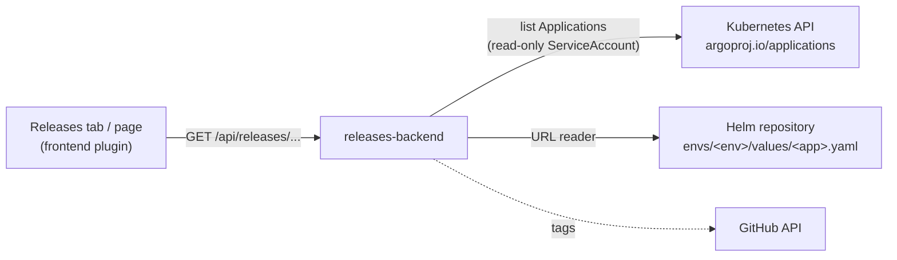

# How it works

| Endpoint | Returns |
|---|---|
| `GET /api/releases/overview` | Every Argo CD Application that carries the label `platform.demo/env`, with sync, health, revision, the images Argo CD sees (`status.summary.images`), the declared digest and the computed state |
| `GET /api/releases/service/<name>?repo=<owner/repo>` | The same for one service, plus the latest release tag of the repository |

The application name is `<env>-<app>` (the ApplicationSet's convention); the values file is read from the URL template
`releases.valuesUrl`. All reads are read-only and require a signed-in user.
